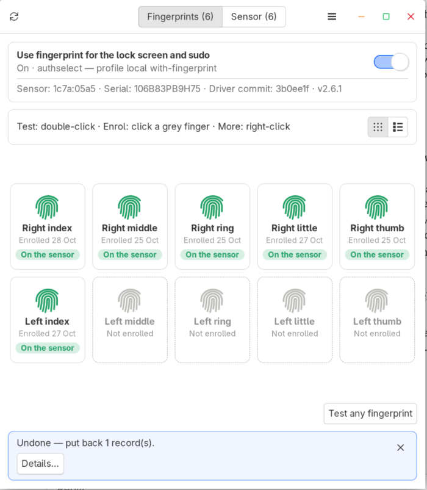
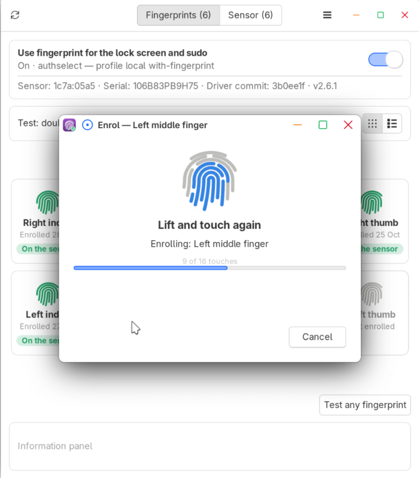
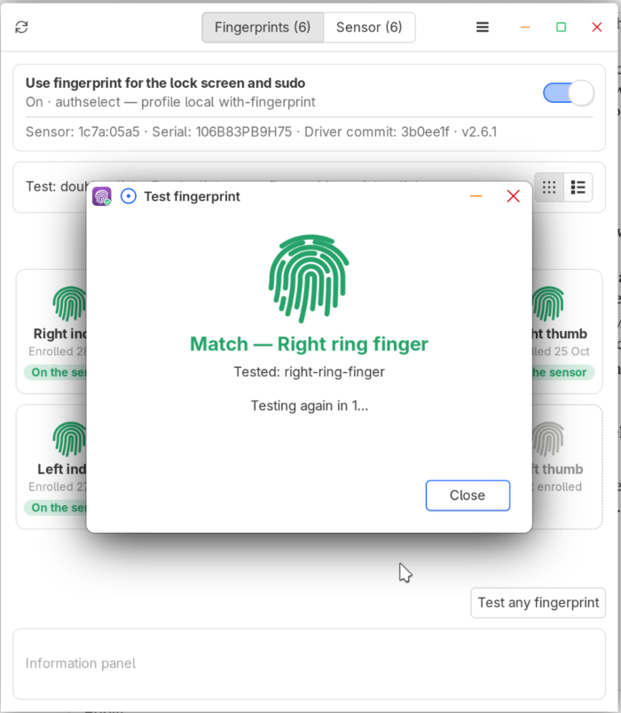

# Fingerprint Fix for the Samsung Galaxy Book4 and Book5

Makes the fingerprint reader work on Linux on the **Samsung Galaxy Book4 and Book5** (Egis readers `1c7a:05a5` and `1c7a:05a1`): fingerprint login, the lock screen, `sudo` and admin prompts. It adds only the reader's driver, for fprintd alone; **your distro's libfprint is not replaced.**

> [!IMPORTANT]
> - **Only for the Galaxy Book4 and Book5** with an Egis reader: check with `lsusb | grep 1c7a` (`05a5` or `05a1`). Not the Galaxy Book3, nor the ARM-based Book4 Edge: the packages refuse to install there.
> - **Windows on the same laptop?** Disable its fingerprint reader in Windows Device Manager. Otherwise every time Windows starts, it deletes your Linux fingerprints from the sensor.
> - **Several Linux distros on the laptop?** Don't enrol the same finger on each: that deletes it from the others. Enrol once and share it: the Galaxy Book Fingerprint Manager offers it on your other distros by itself (see [Multi-Distro Mode](#multi-distro-mode)).

## Install

Each distro has two files in the [**latest release**](https://github.com/david-bartlett/fingerprint-fix-sdcp/releases/latest):

- **The driver** (`fingerprint-fix-sdcp`) makes the reader work. With it alone, enrol in your desktop's own fingerprint settings.
- **The [Galaxy Book Fingerprint Manager](#galaxy-book-fingerprint-manager)** (`galaxybook-fingerprint-manager`) is **optional**: a window to enrol, test and remove fingerprints, see the sensor's slots and share fingerprints between installs, plus checks that tell you when something goes wrong (e.g. Windows deleted your fingerprints).

Download the files for your distro, open a terminal in that folder and run the command. It installs both; for the driver alone, leave out the Manager's file.

<details>
<summary>Expand for a list of package names for each distro</summary>

| Distro | Command |
| --- | --- |
| Fedora 45 | `sudo dnf install ./fingerprint-fix-sdcp-*.fc45.x86_64.rpm ./galaxybook-fingerprint-manager-*.fc45.noarch.rpm` |
| Fedora 44 | `sudo dnf install ./fingerprint-fix-sdcp-*.fc44.x86_64.rpm ./galaxybook-fingerprint-manager-*.fc44.noarch.rpm` |
| Ubuntu 26.04, Linux Mint 27 | `sudo apt install ./fingerprint-fix-sdcp_*ubuntu26.04_amd64.deb ./galaxybook-fingerprint-manager_*ubuntu26.04_all.deb` |
| Ubuntu 24.04, Linux Mint 22, Zorin OS 18 | `sudo apt install ./fingerprint-fix-sdcp_*ubuntu24.04_amd64.deb ./galaxybook-fingerprint-manager_*ubuntu24.04_all.deb` |
| Debian 13, MX Linux 25 | `sudo apt install ./fingerprint-fix-sdcp_*debian13_amd64.deb ./galaxybook-fingerprint-manager_*debian13_all.deb` |
| Arch, CachyOS, EndeavourOS | see [Arch-based distros](#arch-based-distros) below |

</details>

Fingerprint login (lock screen, `sudo`, admin prompts) is turned on at the first install, and updates leave it as you set it. You can turn it off later in the Manager (see [Turning Fingerprint Login On or Off](#turning-fingerprint-login-on-or-off)).

<details>
<summary>Installing with fingerprint login off</summary>

| Distro | Command |
| --- | --- |
| Fedora | `sudo FPRINT_PAM=0 dnf install ./fingerprint-fix-sdcp-*.rpm ./galaxybook-fingerprint-manager-*.rpm` |
| Ubuntu, Linux Mint, Zorin OS, Debian, MX Linux | `sudo FPRINT_PAM=0 apt install ./fingerprint-fix-sdcp_*.deb ./galaxybook-fingerprint-manager_*.deb` |
| Arch, CachyOS, EndeavourOS | `makepkg -s`, then `sudo FPRINT_PAM=0 pacman -U ./*.pkg.tar.zst` (`makepkg -si` ignores `FPRINT_PAM=0`) |
| Any, with install.sh | `sudo FPRINT_PAM=0 bash install.sh` |

</details>

Once installed, **[enrol a fingerprint](#enrolling-a-fingerprint)**.

### Arch-based distros

Arch is rolling, so the fix is built on your laptop against your current libraries rather than downloaded ready-made (the usual way on Arch, as with the AUR). Only the one driver is built, so it takes seconds:

```bash
sudo pacman -S --needed base-devel git
```

Download `PKGBUILD`, `fingerprint-fix-sdcp.install` and `galaxybook-fingerprint-manager.install` from the release into an empty folder, then in that folder run `makepkg -si`. Or, all in one go:

```bash
mkdir -p ~/fingerprint-pkg && cd ~/fingerprint-pkg
curl -L -O https://github.com/david-bartlett/fingerprint-fix-sdcp/releases/latest/download/PKGBUILD \
     -O https://github.com/david-bartlett/fingerprint-fix-sdcp/releases/latest/download/fingerprint-fix-sdcp.install \
     -O https://github.com/david-bartlett/fingerprint-fix-sdcp/releases/latest/download/galaxybook-fingerprint-manager.install
makepkg -si
```

(This works in bash, zsh and fish, CachyOS's default shell.)

`makepkg` installs the build tools it needs, builds the driver commit the release was tested with, and asks for your password to install both packages. **Updating:** the Manager's **Update** fetches the new release's `PKGBUILD` and runs `makepkg -si` in your terminal; without the Manager, download the new files and run `makepkg -si` again.

### Installing only one package

Either package works on its own. Most desktops have their own fingerprint settings for enrolling, so the driver alone may be all you need:

| Install only | What you get | What you don't |
| --- | --- | --- |
| **The driver** (`fingerprint-fix-sdcp`) | Fingerprints work, and fingerprint login is turned on. Enrol in your desktop's settings (GNOME, KDE, Mint's Fingerprints) | The Galaxy Book Fingerprint Manager's window, the monitor (e.g. *your distro now supports the reader*) and the boot check (warns when Windows deletes your fingerprints) |
| **The Galaxy Book Fingerprint Manager** (`galaxybook-fingerprint-manager`) | The window, monitor and checks, using whichever driver fprintd has: for when your distro's own libfprint supports the reader with SDCP | The driver: on a distro without SDCP support the Galaxy Book Fingerprint Manager can't use the reader |

Install just that file, e.g. `sudo dnf install ./fingerprint-fix-sdcp-*.fc45.x86_64.rpm`, `sudo apt install ./galaxybook-fingerprint-manager_*ubuntu26.04_all.deb`, or on Arch `makepkg -s` then `sudo pacman -U ./<package>-*.pkg.tar.zst`. With `install.sh`: `sudo bash install.sh --driver-only` or `--manager-only`. The other part can be added later the same way. The Manager's **Update** updates whatever is installed: both packages, or only the Manager.

### Other distros: install.sh

For a distro without a package, or for testing. Needs `git` and an internet connection (the installer downloads and builds the driver):

```bash
git clone https://github.com/david-bartlett/fingerprint-fix-sdcp
cd fingerprint-fix-sdcp
sudo bash install.sh
```

The installer checks your distro, installs the build packages it needs, builds the driver and sets everything up; at the end it offers to open the Manager. It works on Fedora, Debian / Ubuntu and their derivatives (Linux Mint, Zorin, Pop!_OS, MX Linux…) and Arch-based distros. `/etc/samsung-galaxybook-egismoc-sdcp.installed` records the installed version, the driver commit, its date and where it came from. Each release builds one tested driver commit (see [Releases](https://github.com/david-bartlett/fingerprint-fix-sdcp/releases) and [CHANGELOG.md](CHANGELOG.md)).

**Updating:** in the `fingerprint-fix-sdcp` folder, run `git pull`, then `sudo bash install.sh` again. Enrolled fingerprints are kept.

## Updating

You're told about each new release with a notification, checked 30 seconds after login and then hourly. With the Galaxy Book Fingerprint Manager, click its **Update** button: it downloads the new files and installs them in a terminal window, where you confirm with your fingerprint or password. Without it, download the new files and install them the same way. Enrolled fingerprints are always kept.

<details>
<summary>Turning the update check off, and how it works</summary>

- The notification comes once per version, with **Open GitHub** (the release page) and, with the Manager, **Open Fingerprint Manager**. On GNOME, hover over it to see the buttons.
- Only one check runs: the driver's own check is skipped while the Manager is installed.
- With no terminal found, the Manager's **Update** saves the files to `~/Downloads` instead, with the command to paste.
- **Turn it off** in the Manager: ☰ → *Check for new versions*. With the driver alone: `systemctl --user mask fingerprint-fix-sdcp-update-check.timer` (off) and `systemctl --user unmask fingerprint-fix-sdcp-update-check.timer` (on); for an `install.sh` copy, `systemctl --user disable` / `enable`.
- Turning it off in the Manager also turns off the driver's check, and that stays off if you remove the Manager; removing it tells you so, with a **Turn on** button.
- `install.sh` copies: in the `fingerprint-fix-sdcp` folder, `git pull`, then `sudo bash install.sh` again.

</details>

## Uninstall

Installed from a package — remove both with your package manager:

```bash
sudo dnf remove fingerprint-fix-sdcp galaxybook-fingerprint-manager      # Fedora
sudo apt remove fingerprint-fix-sdcp galaxybook-fingerprint-manager      # Ubuntu, Mint, Debian, MX
sudo pacman -R fingerprint-fix-sdcp galaxybook-fingerprint-manager       # Arch, CachyOS
```

Installed with `install.sh` — from its folder:

```bash
sudo bash uninstall.sh
```

Enrolled fingerprints are always kept, so reinstalling uses them again, and fingerprint login stays as you set it.

<details>
<summary>Removing only one part, and what's kept</summary>

**Only the driver** — e.g. once your distro's own libfprint handles the reader with SDCP (the monitor tells you, and the Galaxy Book Fingerprint Manager offers it): `sudo dnf remove fingerprint-fix-sdcp` (or `apt remove` / `pacman -R` the same name), or `sudo bash uninstall.sh --driver-only`. fprintd goes back to your distro's libfprint; the Manager, its checks and fingerprint login stay.

**Only the Manager:** `sudo dnf remove galaxybook-fingerprint-manager` (or `apt remove` / `pacman -R`), or `sudo bash uninstall.sh --manager-only`. The driver, fingerprint login and enrolled fingerprints stay.

Either way, enrolled fingerprints are always kept — fprintd's records and the templates on the sensor — so reinstalling uses them again. To delete fingers, use the Manager before uninstalling (while the driver is still loaded, so the templates leave the sensor too). Both remove the drop-in, the library, the Manager and the monitor; nothing needs reinstalling because the distro libfprint was never replaced. Fingerprint login is left as you set it, on every distro, so it keeps working once your distro's libfprint has SDCP.

To switch an `install.sh` copy off temporarily instead:

```bash
sudo mv /etc/systemd/system/fprintd.service.d/samsung-galaxybook-egismoc-sdcp.conf /root/
sudo systemctl daemon-reload && sudo systemctl restart fprintd
```

</details>

## Supported Hardware

**Confirmed working:** Galaxy Book5 Pro 14" (940XHA, reader `05a5`) on Fedora 45, Ubuntu 26.04, Linux Mint 22.3 and 27, MX Linux 25 and CachyOS; Galaxy Book4 (reader `05a1`) on Zorin OS 18. Find your reader with `lsusb | grep 1c7a`.

<details>
<summary>Test details by reader</summary>

| USB ID | Galaxy Book Model | Status |
| --- | --- | --- |
| `1c7a:05a5` | Galaxy Book4 / Book5 Pro | **Confirmed working** on Galaxy Book5 Pro 14" (940XHA): Fedora 45, Linux Mint 27 (beta), Linux Mint 22.3 (OpenSSL 3.0.13 — needs commit 3b0ee1f or later), Ubuntu 26.04, MX Linux (Xfce) and CachyOS (KDE), 2026-10-24/25 |
| `1c7a:05a1` | Galaxy Book4 (ETU905A80-E) | **Confirmed working** on a Galaxy Book4 by [@gabaritei88](https://github.com/gabaritei88) (firmware 9050.1.2.33): Zorin OS 18.1 (Ubuntu 24.04 base, OpenSSL 3.0.13 — needs commit 3b0ee1f or later), driver installed for fprintd only, enrol, verify and PAM login working; the 4 existing Windows Hello templates on the sensor were kept, 2026-10-26. Also tested upstream with this build (597 logins through `pam_fprintd`). On a Galaxy Book4 (960XGL) with Ubuntu 26.04 (libfprint 1.95.1+tod1), Ubuntu's own egismoc driver lists the reader but without SDCP, so it can't keep fingerprints — this fix is needed there too, 2026-10-27 |

</details>

The **Galaxy Book3** can have the `05a1` reader too, but nobody has tested this fix on one, so `install.sh`, the `.rpm`, the `.deb` and the Arch `PKGBUILD` refuse to install there (a Book3 is recognised by its model name, or its model code: the letter after `X` or `Q` is `F` for the Book3, `G` for the Book4 and `H` for the Book5 — e.g. `940XFG`, `960XGL`, `940XHA`). To try it anyway: `FPRINT_SDCP_FORCE=1`. If it works on your Book3, please tell us with the form below.

Only 64-bit Intel/AMD (`x86_64`) Galaxy Books are supported. The ARM-based **Galaxy Book4 Edge** (Snapdragon) isn't: every install method refuses on an ARM processor.

Got it working on a model or distro not listed here? Please tell us with the [**It works on my laptop / distro**](https://github.com/david-bartlett/fingerprint-fix-sdcp/issues/new?template=works_on.yml) form — that's how this list grows.

## Galaxy Book Fingerprint Manager

A small window for your fingerprints and the sensor, in the app menu as **Galaxy Book Fingerprint Manager** (or run `galaxybook-fingerprint-manager`, as yourself, not with sudo). It asks for your password once per session.

- **Fingerprints tab:** your ten fingers. Click a grey one to enrol it, double-click one to test it, click one for its details, right-click for more (enrol again, remove). **Remove all from <distro>…** takes all your fingers off this distro at once; their slots stay on the sensor, so ☰ → **Restore <distro> fingerprints…** brings them back.
- **Sensor slots tab** (off unless you turn it on with ☰ → **Show sensor slots**; there by itself when other distros use the sensor): the sensor's 10 slots, which are used and which are free. Clear slots you don't need. The ⓘ button explains what a slot is. While it's off, **Show on sensor** (or a full sensor) opens it just for that visit.
- **The switch at the top** turns fingerprint login on or off.
- **☰ menu:** restore fingerprints removed here, show the sensor slots, test whether your distro's own driver now works, check for updates. With other distros on the laptop, more appear: importing their fingerprints, back up & restore, and reset (see [Multi-Distro Mode](#multi-distro-mode)).
- **Information panel** at the bottom: what just happened (it blinks, and stays until you close it), and the details of a finger or slot you click (gone after 5 seconds).

> [!NOTE]
> **What's a slot?** The sensor has 10 slots, and each holds one enrolled fingerprint: from this Linux, another Linux on the laptop, or Windows Hello. Your fingerprint never leaves the sensor; Linux only notes which slot holds which finger.
> - **Removing a finger** (Fingerprints tab) only takes it off this Linux. Its slot stays filled, so other installs keep it and you can restore it.
> - **Clearing a slot** (Sensor slots tab) erases the fingerprint itself, for every install. It can't be undone: that finger has to be enrolled again.

<p>
  
  
</p>
<p>
  
  
</p>

<details>
<summary>How it works, in detail</summary>

Only one window runs at a time: starting it again brings the open window forward (or makes it flash in the taskbar, depending on the desktop). The installed copy is owned by root (`/usr/local/lib/galaxybook-fingerprint-manager/`, or `/usr/lib/galaxybook-fingerprint-manager/` from a package), because its helper runs as root: a copy in your home folder could be changed by any program running as you. ☰ → **About** shows its version, the installed version and driver commit, and where it came from.

It asks for your password once per session; the prompt says "Galaxy Book Fingerprint Manager needs administrator access to read and manage the fingerprint sensor" (a polkit policy installed for the helper). At the top is a **Use fingerprint for …** switch (its title says what it covers on this system — login, the lock screen and sudo on GNOME and Mint, the lock screen and sudo on KDE, sudo and admin prompts on Arch-based distros) and a line about the sensor, the installed version and the driver commit; below are two tabs:

- **Fingerprints** — your enrolled fingers on this install, and whether the sensor still has each one, as **cards** (all ten of your fingers, right hand then left, like Linux Mint's fingerprint settings; grey dashed = not enrolled, click one to enrol that finger) or as a **list** (a row per enrolled finger, for every user, with its own Test button; other users' fingers are only in the list). The buttons at the top right switch between them (on both tabs), and the choice is remembered. Click a card or row to select it (one at a time, on both tabs) and see its details in the information panel: when it was enrolled and its template (with other distros, also which one enrolled it and which use it); click it again to deselect it. Double-click one of your fingers to test it. Right-click a finger for a menu: **Test**, **Enrol again…** (replace it with a fresh enrolment, if it doesn't match reliably), **Show on sensor** and **Remove from <distro>** (e.g. "Remove from Fedora", the name from /etc/os-release); for a red (dead) finger **Remove dead record…** and **Enrol this finger again…** (removes the dead record, then enrols that finger); for a grey finger **Enrol…** and **Restore removed fingerprint…** (puts back a record removed earlier, if its template is still on the sensor). On the Sensor slots tab, right-click a template for **Show finger** and **Clear slot…** (deletes its fingerprint from the sensor, for every install). A finger you removed from this distro still has its template on the sensor; it shows as that finger with an amber **Removed here** label (not as an unknown template), and its right-click menu has **Restore to <distro>**. Green = on the sensor; red = a dead record (its template was re-enrolled elsewhere or removed by Windows), which also shows a warning with a **Remove dead records** button; amber with ⚠ and **Other driver** = enrolled with a different fingerprint driver (e.g. your distro's own, before this fix), which can never match here — a warning offers **Delete them**, and its right-click menu has **Delete and enrol again…** (deletes its old template from the sensor too, freeing the slot) and **Delete…**.
- **Sensor slots** (off by default, unless other distros use the sensor: ☰ → **Show sensor slots**; while it's off it appears just for a visit when something opens it, e.g. **Show on sensor**) — the sensor itself: how many of the sensor's 10 slots are used, and every template on it: green = used by this install (with the user and finger), grey = not used here, dashed = free. A slot no install has noted shows as "Unknown": Windows Hello's own (Windows wipes Linux's templates but keeps its own), another distro, or one left over from a reinstall. Templates not used here are never deleted without a warning. With other distros, slots also say which of them use each (see [Multi-Distro Mode](#multi-distro-mode)). Click a slot to see its details in the information panel (who it is, which distros use it, its template, and any distro not seen for a month); click it again to clear them. Shown as cards or a list, like the Fingerprints tab; the Cards / List choice applies to both tabs.

<details>
<summary>Show every button and what it does</summary>

| Where | Control | What it does |
|---|---|---|
| Top | Use fingerprint for … | Turns PAM fingerprint on or off with `fingerprint-pam.sh` (see below). Turning it off keeps your enrolled fingerprints |
| Fingerprints | Test any fingerprint (or double-click a finger) | The button checks your touch against all your fingers (as login and sudo do); double-clicking a finger tests just that one. Shows a clear Match / No match with the finger that matched. It asks the sensor directly (fprintd pauses for a moment), because fprintd doesn't report which finger matched |
| Fingerprints | Enrol a finger (a grey card, or the last row) | Enrols a new finger for you with `fprintd-enroll`, with a progress bar. It warns first that enrolling a finger already stored for another install or Windows Hello deletes it from there — useful on desktops without a fingerprint settings page, such as Xfce (MX Linux) |
| Fingerprints | Remove from <distro> (right-click a finger, or select it and press Delete) | Moves the record off this install; the template stays, so installs sharing it keep working |
| Fingerprints | Remove all from <distro>… | **Remove from <distro>** for all your fingers at once: the records are moved aside, their slots stay on the sensor, and ☰ → **Restore <distro> fingerprints…** (with **Select all**) brings them back |
| Sensor slots | Clear… (or right-click → Clear slot…) | Clears the selected slots: deletes their fingerprints from the sensor (and moves aside any record here that used them) |
| Sensor slots | Clear all slots… | Deletes every fingerprint on the sensor (every Linux install's and Windows Hello's) after you type CLEAR; moves every record here aside |
| ☰ menu | Restore <distro> fingerprints… | Lists records moved to `removed-fingerprints/` or `replaced-fingerprints/` and puts the chosen ones back — only if their template is still on the sensor and that finger hasn't been enrolled again here |
| ☰ menu | Test your distro's driver… | Checks whether your distro's own libfprint can replace this fix: if it has an SDCP driver for the sensor (from the distro, not another fix), fprintd is switched to it for a moment and one of your fingers is checked with it — the way login would work without the fix. A match offers **Remove fingerprint-fix-sdcp** (or **Copy command**): it removes the fix the way it was installed, keeping your fingerprints, and the Galaxy Book Fingerprint Manager closes. No match: keep the fix, or delete your fingers here first (so they don't stay on the sensor) before switching. The fix is always switched back on after the test |
| ☰ menu | Remind me about Windows | Shows or hides the dual-boot reminder (only in the menu when Windows is found) |
| Fingerprints | Delete and enrol again… / Delete… (right-click an **Other driver** finger) | Deletes a finger enrolled with another driver — its template on the sensor too — and optionally enrols it again with this fix |

</details>

Results appear in the **information panel** at the bottom of the window — blue for information, amber for warnings, red for errors — with the full script output behind **Details…**. They blink to catch your eye and stay until you close them or a newer one replaces them. The details of a finger or slot you click show in grey, without blinking, and go after 5 seconds or when you change tabs.

Other things it can show:

- **Windows on the same laptop** — a reminder at the bottom of the window to disable the fingerprint reader in Windows (see [Dual-Boot With Windows](#dual-boot-with-windows)). **Got it** hides it; ☰ → **Remind me about Windows** (only there when Windows is found) brings it back.
- **Your distro's libfprint now supports the reader** — when the distro's own, unmodified libfprint gains an SDCP driver for it, a message with **Test your distro's driver** (also in the ☰ menu). If it's an SDCP libfprint from another fix instead, a warning to keep this fix. See [The Monitor](#the-monitor).
- **No Galaxy Book reader** — started on a computer without `1c7a:05a5` / `1c7a:05a1`, it says what it's for and how to remove the fix, instead of asking for a password.

Records are never deleted: removed ones go to `/var/lib/samsung-galaxybook/removed-fingerprints/<date>/`, and are kept while they can still be restored: a copy goes once its slot is cleared or the finger is back in it. Each sensor job stops fprintd for a moment, as the sensor can only be used by one program at a time.

The installer installs the packages it needs. If any are missing later, the launcher lists them with the command to install them (from a terminal it offers to run it) — PyGObject with GTK 3, libfprint's GObject introspection data and pkexec:

- Fedora: `sudo dnf install python3-gobject python3-cairo gtk3` (introspection data comes with libfprint)
- Debian / Ubuntu / Mint / MX: `sudo apt install python3-gi python3-gi-cairo gir1.2-gtk-3.0 gir1.2-fprint-2.0 pkexec`
- Arch / CachyOS: `sudo pacman -S python-gobject python-cairo gtk3` (introspection data comes with libfprint)

</details>

## Dual-Boot With Windows

The sensor has a single template store shared by every OS:

- **Windows** removes templates it did not create when its biometric service starts, so booting Windows with the sensor enabled deletes your Linux enrolments. Disable the fingerprint device in Windows Device Manager if you dual-boot. When Windows is installed on the laptop, the Galaxy Book Fingerprint Manager shows this reminder at the bottom of its window (hide it with **Got it**; ☰ → **Remind me about Windows** brings it back). It looks for a Windows Boot Manager boot entry whose partition still exists, and Windows' own partitions (NTFS or BitLocker, plus the Microsoft Reserved or Windows Recovery partition) — no password needed, and nothing is mounted.
- **fprintd** deletes an unknown template when you enrol a finger that matches it, and deletes unknown templates when the sensor is full. Enrolling the same finger in two Linux installs breaks the first one — use a different finger per install, or share one enrolment between installs (see [Multi-Distro Mode](#multi-distro-mode)).

## Enrolling a Fingerprint

Open **Galaxy Book Fingerprint Manager** from the app menu and click a grey finger, or use your desktop's settings: KDE: System Settings → Users → Fingerprint Authentication · GNOME: Settings → System → Users → Fingerprint Login · Mint: Menu → Fingerprints · Xfce (e.g. MX Linux) has none: use the Manager or `fprintd-enroll`. No reboot is needed. Check with `fprintd-verify`.

If `fprintd-verify` never matches, those fingers were enrolled with another driver (e.g. your distro's own, before this fix): the Manager marks them **Other driver** and offers to delete and enrol them again.

## Turning Fingerprint Login On or Off

`fingerprint-pam.sh` turns fingerprint for login, sudo and admin prompts on or off the way each distro expects — the installer and the Galaxy Book Fingerprint Manager both use it, so it also puts things right if the PAM setting was lost:

```bash
bash tools/fingerprint-pam.sh status
sudo bash tools/fingerprint-pam.sh enable
sudo bash tools/fingerprint-pam.sh disable    # enrolled fingerprints are kept
```

| Distro | How |
| --- | --- |
| Fedora | `authselect enable-feature with-fingerprint` / `disable-feature` |
| Ubuntu, Debian, MX Linux | `pam-auth-update` profile `fprintd` (from `libpam-fprintd`) |
| Linux Mint | `pam-auth-update` profile `fingwit` (Mint's own; it conflicts with `fprintd`'s, which is turned off) |
| Arch-based | `arch-pam.sh` — sudo and polkit-1 (below) |

## Fingerprint for sudo and Admin Prompts on Arch-Based Distros

<details>
<summary>Show the Arch details</summary>

Arch, CachyOS, Manjaro, EndeavourOS and other Arch-based distros have no authselect or pam-auth-update, so the installer asks:

```
Enable fingerprint for sudo and admin prompts? [Y/n]
```

It waits for an answer (no time limit, because it changes how you log in to sudo) and is skipped when there is no terminal. `FPRINT_PAM=1` or `FPRINT_PAM=0` answers it in advance. The same is available any time with `fingerprint-pam.sh`, or directly with `arch-pam.sh`:

```bash
sudo bash tools/arch-pam.sh enable     # sudo + polkit-1 (pkexec, graphical admin prompts)
sudo bash tools/arch-pam.sh status
sudo bash tools/arch-pam.sh disable    # removes exactly what 'enable' added
sudo bash tools/arch-pam.sh update     # brings lines added by an older version up to date
```

What it does:

- Adds one `auth sufficient pam_fprintd.so` line, marked with a comment, above the first `auth` line of `/etc/pam.d/sudo` and `/etc/pam.d/polkit-1`. `polkit-1` normally lives only in `/usr/lib/pam.d`, so it is copied to `/etc/pam.d` first (that copy takes precedence).
- In `polkit-1` the line has `timeout=10`. Admin dialogs show a password box straight away, but polkit only checks a typed password once the fingerprint step gives up — after 3 tries or 30 seconds by default (a known polkit limitation, the same on Fedora: [KDE Discuss](https://discuss.kde.org/t/polkit-authentication-not-usable-with-password-only-fingerprint/46150)). With `timeout=10` a typed password goes through after at most 10 seconds; touching the sensor still works at once. `sudo` keeps the default, since Ctrl+C there skips straight to the password.
- Keeps a backup of each file (`*.bak-samsung-galaxybook`), and checks the edited file still contains every original line.
- Leaves any file that already mentions `pam_fprintd` alone, so hand edits are never overwritten and running it twice changes nothing.
- Is safe before enrolling: with no finger enrolled, `pam_fprintd` reports "not available" and you are asked for your password as usual.
- Uninstalling the fix leaves them, so fingerprint login keeps working once your distro's libfprint has SDCP. To take them out, run `sudo bash tools/arch-pam.sh disable` (or turn fingerprint login off in the Galaxy Book Fingerprint Manager) first: only the marked lines are removed, and the `polkit-1` copy is deleted if it was created by the fix and not changed since.

**Not changed:** the **KDE lock screen** already uses the fingerprint through its own `kde-fingerprint` service, and the **login screen** is left password-only (with fingerprint, Plasma's login screen waits for the sensor after you type a password).

Test in a new terminal with `sudo -k; sudo true` and `pkexec true`. Keep a root terminal open (`sudo -i`) while testing PAM changes.

**Tested** on CachyOS (KDE): `enable`, `disable`, `enable` again, with sudo and pkexec both accepting the fingerprint (2026-10-25).

**If the lock screen locks you out after a few successful fingerprint unlocks** — a known KDE Plasma 6 bug where `pam_faillock` counts successful fingerprint scans as failures — copy `/usr/lib/pam.d/kde-fingerprint` to `/etc/pam.d/kde-fingerprint` and use:
```
#%PAM-1.0
auth [success=1 ignore=ignore module_unknown=die default=bad] \
     pam_fprintd.so max-tries=3 timeout=65535
auth [default=die] pam_faillock.so authfail
auth optional pam_permit.so
auth required pam_faillock.so authsucc
auth required pam_env.so
account include system-local-login
password required pam_deny.so
session include system-local-login
```

> ⚠️ Always keep a root terminal open while editing PAM files.

</details>

## The Monitor

<details>
<summary>Show how the monitor works</summary>

A user timer fires 10 seconds after login and starts a root service (allowed by a polkit rule). The service:

- notifies you if the fix's library or drop-in has gone missing;
- when the **distro libfprint changes**, checks whether it now has an SDCP driver for the sensor (`lib/distro-driver-check.py`: it lists USB devices with the distro library, as root — some libfprint builds open the reader while listing it — and fprintd keeps running), and where that library came from: only the distro's own, unmodified libfprint package counts. An SDCP build from another fix — copied over the distro's file (it no longer matches its package's checksum), not owned by any package, or from a COPR, PPA, the AUR or a local package — gets a warning to keep this fix instead, since the next distro update may replace it. If it's the distro's own, you are told once that the fix may no longer be needed, and to try **Test your distro's driver** in the Galaxy Book Fingerprint Manager's menu first. That test switches fprintd to the distro library for a moment and checks one of your enrolled fingers with it, the way login would work without the fix; if it matches, the Manager offers to remove the fix for you. The fix never removes itself;
- notifies you if fprintd cannot see the sensor at all;
- notifies you if fprintd isn't running this fix's driver, naming any other fingerprint fix's fprintd setting that overrides it (added after this fix was installed). Reinstalling the fix moves it aside.

Notifications are written to `/run/samsung-galaxybook/fprint-sdcp-status` and shown by the user check script in your own session.

</details>

## Boot-Time Sensor Check

<details>
<summary>Show how the boot-time check works</summary>

Windows Hello deletes templates it did not create when Windows boots with its fingerprint device enabled, so your Linux fingerprints can vanish from the sensor while their records remain. Without a check, the fingerprint just stops working with no explanation.

At every boot, a small service compares fprintd's records with the templates actually stored on the sensor:

- It runs **before fprintd starts**, so nothing else can use the sensor while it checks, and nothing needs pausing. It runs in parallel with the rest of the boot — only fprintd waits for it, and only for the second or two it takes — so boot is not slower.
- If a fingerprint's template is gone, the login check shows **Fingerprint Removed From Sensor** (once per boot) naming the finger, at the first login after the wipe — before you try to use it.
- It **clears only the dead fingers' records**, so your desktop's fingerprint settings show them as not enrolled and you can simply add them again. Fingerprints still on the sensor are not touched. (Windows normally removes every Linux fingerprint, so in practice that is usually all of them.)
- Cleared records are **moved, not deleted**, to `/var/lib/samsung-galaxybook/removed-fingerprints/<date>/` (the Manager deletes them once it finds their slots really gone). They are useless once the template is gone, but if the check were ever wrong they could be moved back.
- Each Linux install that shared the fingerprint clears its own dead record at its own next boot.
- Fingerprints **enrolled with another driver** (the distro's own egismoc driver, or another non-SDCP build) are not treated as removed: they can never match here, so the login check says so once (**Fingerprints From Another Driver**) and they are left for you to delete and enrol again in the Galaxy Book Fingerprint Manager.
- A fingerprint removed from the sensor can't be brought back by an import or a backup: those only point at its slot, and the slot is what was deleted.

The check is a small Python program (`lib/sensor-check.py`) that uses whichever libfprint drives the reader — this fix's driver, or your distro's once it has SDCP and the driver is removed. It gives up after a few seconds if the sensor does not appear, and never fails the boot. Its output is in `journalctl -u samsung-galaxybook-fprint-sdcp-boot-check`.

</details>

## Multi-Distro Mode

Everything above is all one distro needs. This section is for laptops with **several Linux distros** using the one sensor.

**The Galaxy Book Fingerprint Manager switches to multi-distro mode by itself.** Each distro that runs it notes itself (and where it's installed: its partition) in one file on the EFI partition, `EFI/samsung-galaxybook/fingerprint-slots.json`, which every OS on the laptop shares and which survives reinstalling a distro. Each time the Manager opens, it reads that file and checks the other distros still exist: one whose partition has been deleted or reformatted (reinstalled) is no longer listed, and a short message says so. A distro on a second drive that isn't connected is left as it is. As soon as another distro is found, the multi-distro parts appear: the **Sensor slots** tab, and in the ☰ menu **Import from other distros…**, **Back up & restore…** and **Reset <distro>…**. When the others are gone, it goes back to single-distro mode. (`galaxybook-fingerprint-manager --single-distro` shows the single-distro layout anyway, e.g. to try it; only what's shown changes.)

### Sharing Fingerprints

Enrol each finger **once** and share it, instead of enrolling it again on every distro. Enrolling the same finger on another distro deletes it from the others, and sharing keeps the sensor's 10 slots free. fprintd's record for a finger holds only the ID of its slot on the sensor (no fingerprint image, no secret), so the same record works on every distro that runs this fix.

1. Each distro notes its fingers' records in the shared file on the EFI partition.
2. When the Manager opens on another distro (a new one, a reinstalled one, or one you've just reset), it asks *Use these fingerprints on CachyOS too?* and lists the fingers it could use, each with the distros it's from.
3. Untick any that aren't yours, then **Import**. They work straight away, with no enrolling.

Turned one down? It isn't offered again by itself, but ☰ → **Import from other distros…** always lists them all. A finger you removed here comes back with ☰ → **Restore <distro> fingerprints…** (or right-click it → **Restore removed fingerprint…**). A record goes when its slot is cleared, so you're never offered a finger that can't match.

- **Don't enrol the same finger on another distro.** Import it instead.
- **Remove** (Fingerprints tab) takes a finger off one distro only; the others keep it. **Clear slot** (Sensor slots tab) erases it from the sensor, for every distro.
- With several distros, clicking a finger or slot also shows which distro enrolled it and which use it.

### Reinstalling or Removing a Distro

- **Reinstalling:** just reinstall it. When the Manager opens on the new install, it offers your fingerprints; nothing to enrol again. The old install is noticed as gone (its partition was reformatted) and no longer listed.
- **Removing:** removing the Manager (dnf / apt / pacman, or `uninstall.sh`; not an update) takes this distro out of the file. A distro deleted without that is noticed as gone at the next start of the Manager elsewhere; **Other distros…** on the Sensor slots tab lists them all and can **Forget…** one by hand.

### Reset

☰ → **Reset <distro>…** deletes that distro's fingerprints for good, and erases from the sensor **the slots no other distro uses**: nothing can bring those fingers back (not an import, not a backup); they have to be enrolled again. Slots other distros also use are kept, and you're asked straight after whether to import them again. The confirmation names which fingers are lost and which are kept. The distro is also taken out of the shared file. You don't need it to reinstall a distro.

### Back Up & Restore

The file on the EFI partition holds every distro's records. Formatting that partition (reinstalling Windows can) loses them: your fingerprints are still on the sensor, but no distro knows which slot is whose. A backup puts them back.

☰ → **Back up & restore…** says how many records the file has, and:

- **Back up…** saves a copy of it, e.g. `~/galaxybook-fingerprints-2026-10-29.json`. Keep it somewhere safe, such as a USB stick. Make a new one after enrolling new fingers.
- **Restore…** puts a backup's records back. Records already there are kept as they are; only missing ones are added. Then the Manager offers the fingers this distro can use, and the other distros offer theirs the next time it opens there.

A backup holds no fingerprints, only which slot is whose: it's useless without this laptop's sensor and your finger. A finger whose slot has been cleared since the backup can't be restored; enrol it again.

<details>
<summary>The multi-distro buttons</summary>

| Where | Control | What it does |
|---|---|---|
| ☰ menu | Import from other distros… | The fingers this install could use from the other distros on the laptop (also ones you turned down before), ticked ones imported through `import-fingerprint.sh` with all its checks |
| ☰ menu | Reset <distro>… | Deletes this distro's fingerprints for good: clears the slots only it uses (they have to be enrolled again), keeps the ones other distros also use and offers them back, and takes it out of the shared slots file. The confirmation names the fingers lost and kept. Not needed to reinstall a distro |
| Sensor slots | Other distros… | Every distro in the shared slots file, with the date it last opened the Manager and its slots. **Forget…** takes a wiped or reinstalled one out; **Forget and clear N slots** also erases the slots only it used. Also in the ⓘ dialog. Only shown when other distros are listed |
| ☰ menu | Back up & restore… | Says how many records the EFI partition has; **Back up…** saves a copy of `fingerprint-slots.json` from the EFI partition (every distro's records) as a `.json` file; **Restore…** merges one back (adds what's missing, changes nothing there) and the Manager offers the fingers again |

</details>

### Without the Manager

A distro with only the driver doesn't use the shared file, and the export and import tools come with the Manager (or a `git clone` of this repository). Share fingerprints with an export file instead. On the distro where the fingers are enrolled:

```bash
sudo bash tools/export-fingerprint.sh     # writes ~/fingerprint-export.tgz
```

Copy that file to your home folder on the other distro, then:

```bash
sudo bash tools/import-fingerprint.sh     # reads ~/fingerprint-export.tgz
```

`install.sh` imports `~/fingerprint-export.tgz` by itself when it's there. Only fingers whose slot is still on the sensor are imported, fingers you already have are kept, and the user name doesn't have to match (that needs the Manager installed). Export again after deleting or re-enrolling a finger: an old export points at slots that no longer exist.

## More Details

<details>
<summary>What installing does</summary>

1. Checks the sensor is present
2. Installs build dependencies, fprintd and fprintd's PAM module
3. Exits without changes if the distro libfprint already has an **SDCP** driver for the sensor (override with `FORCE=1`). The distro's older egismoc driver also claims `1c7a:05a1`, but without SDCP it can't keep prints on these readers, so it doesn't count
4. Fetches the driver commit named in `DRIVER` (the one this release was tested with) from the fork and builds the egismoc driver only (`-Ddrivers=egismoc -Dtod=false`)
5. Installs the library to `/usr/local/lib/libfprint-egismoc-sdcp/` and adds a systemd drop-in so **only fprintd** loads it (`LD_LIBRARY_PATH`), and only while the Galaxy Book's reader is present: each time fprintd starts, the drop-in checks for `1c7a:05a5` / `1c7a:05a1` on USB, so on other hardware fprintd keeps the distro libfprint and its drivers
   - If another fingerprint fix's fprintd setup is found — most often a manual install of [Abdallah's libfprint-egismoc-sdcp](https://github.com/abdallah-alkanani/libfprint-egismoc-sdcp) from its README (`/etc/systemd/system/fprintd.service.d/egismoc-sdcp.conf` and `/usr/local/lib/libfprint-egismoc-sdcp/`), or any admin fprintd drop-in that sets `LD_LIBRARY_PATH` / `LD_PRELOAD` or replaces `ExecStart` — it is **moved aside** first, to `/var/lib/samsung-galaxybook/other-fingerprint-fix/<date>/` with a `RESTORE.txt` saying how to put it back. Fingerprints enrolled with Abdallah's build keep working (it's the same driver). The packages do the same when installed
6. Turns on fingerprint for login and sudo with `fingerprint-pam.sh` (Fedora: authselect; Ubuntu/Debian/MX: pam-auth-update; Mint: its own `fingwit` profile; Arch-based: asks whether to add fingerprint to sudo and polkit — see [Fingerprint for sudo and Admin Prompts on Arch-Based Distros](#fingerprint-for-sudo-and-admin-prompts-on-arch-based-distros))
7. Installs a login-time monitor and a boot-time sensor check (see [The Monitor](#the-monitor) and [Boot-Time Sensor Check](#boot-time-sensor-check))
8. Offers to import fingerprints exported from another install on this laptop, if `~/fingerprint-export.tgz` exists (see [Sharing Fingerprints](#sharing-fingerprints))
9. Installs the [Galaxy Book Fingerprint Manager](#galaxy-book-fingerprint-manager) and adds it to the app menu, then offers to open it: `Open the Galaxy Book Fingerprint Manager now? [Y/n]` (skipped after 30 seconds, or when there is no terminal or no desktop session; `FPRINT_OPEN_MANAGER=1` or `=0` answers in advance). It opens as you, in your desktop session — never as root

It does **not** delete `/var/lib/fprint`. Deleting fprintd's records by hand leaves the templates on the sensor as orphans.

**With the packages:** The two packages are the driver (`fingerprint-fix-sdcp`) and the [Galaxy Book Fingerprint Manager](#galaxy-book-fingerprint-manager) (`galaxybook-fingerprint-manager`, with the monitor and the boot and login checks). `dnf` and `apt` install what the fix needs from your distro (fprintd, the Manager's GTK libraries…); nothing is compiled on your laptop. Fingerprints work straight away, and on a first install fingerprint login (the lock screen, sudo and admin prompts) is turned on, as `install.sh` does: open **Galaxy Book Fingerprint Manager** from the app menu to enrol a finger. Turn it off there if you prefer, or install with `FPRINT_PAM=0` (e.g. `sudo FPRINT_PAM=0 apt install ./*.deb`). Upgrades and reinstalls keep your choice.

The packages are only for a Samsung with the Egis reader (`1c7a:05a5` / `1c7a:05a1`, see `lsusb | grep 1c7a`): on other hardware the packages and the Arch `PKGBUILD` stop before installing anything (`sudo FPRINT_SDCP_FORCE=1 dnf install …` / `apt install …`, or `FPRINT_SDCP_FORCE=1 makepkg -si`, installs anyway, e.g. for a system image). Either way, fprintd only uses the fix's driver while the reader is present, so another laptop's fingerprint reader keeps working.

- **Already installed with `install.sh`?** The `.rpm` and `.deb` replace it themselves, keeping your fingerprints. On Arch, run `sudo bash uninstall.sh` in the old folder first (pacman won't install over its files).

</details>

<details>
<summary>The problem this fixes</summary>

These sensors are Windows Hello readers that expect the host to use Microsoft's [Secure Device Connection Protocol](https://github.com/microsoft/SecureDeviceConnectionProtocol/wiki/Secure-Device-Connection-Protocol) (SDCP). Released libfprint has no SDCP support for the egismoc driver, so enrolled prints are not kept or the SDCP handshake fails.

</details>

<details>
<summary>Where the driver comes from</summary>

| | |
| --- | --- |
| Base | [libfprint-TOD v1.95.2+tod1](https://gitlab.freedesktop.org/3v1n0/libfprint/-/tree/v1.95.2+tod1) — the released shared SDCP core (Benjamin Berg, Joshua Grisham, Marco Trevisan) |
| Driver | Joshua Grisham's Egis SDCP driver from libfprint [MR !547](https://gitlab.freedesktop.org/libfprint/libfprint/-/merge_requests/547) / `feature/sdcp-v2`, ported onto that core by Abdallah Alkanani |
| Extra fixes | Fresh random nonce for every identify, full certificate-chain, attestation and identity-MAC checks, bounds-checked responses, clean failed opens and suspend; Roman2K's longer finger wait for `05a5`; Philip Walsh's ET171 fixes |
| Source repo | [david-bartlett/libfprint-egismoc-sdcp](https://github.com/david-bartlett/libfprint-egismoc-sdcp), a fork of [abdallah-alkanani/libfprint-egismoc-sdcp](https://github.com/abdallah-alkanani/libfprint-egismoc-sdcp) with its full history and authorship, so new installs don't depend on the original repo staying online |
| Version built | The commit named in the `DRIVER` file — the one each release was tested with (currently `3b0ee1f`, 25 Oct 2026). Syncing the fork changes nothing for users by itself: a new driver commit reaches them only in a new release, after it is tested and put in `DRIVER` |
| Build-time fixes | `lib/patches/*.patch`, applied by the installer to the fetched source **only while the source still needs them** (skipped once the fix is in the source; the install stops if the source has changed so much a fix no longer fits). The installer prints which it applied, and they are recorded in `/etc/samsung-galaxybook-egismoc-sdcp.installed`. None at the moment |

See the upstream [`SDCP.md`](https://github.com/david-bartlett/libfprint-egismoc-sdcp/blob/egismoc-sdcp/libfprint/drivers/egismoc/SDCP.md) for the protocol mapping and trust rules.

</details>

<details>
<summary>Security notes (from upstream)</summary>

- The reader's certificate must chain to Microsoft's certificates and carry the Windows Hello biometric key usage; both attestation signatures and every identity MAC are checked.
- Certificate expiry dates are ignored because these readers ship with expired factory certificates. There is no revocation list or firmware denylist.
- The Linux host holds the SDCP session secret. This protects against a spoofed or replayed USB device, but not against a compromised root account.

</details>

<details>
<summary>Files installed</summary>

- `/usr/local/lib/libfprint-egismoc-sdcp/libfprint-2.so.2` — the egismoc SDCP build
- `/etc/systemd/system/fprintd.service.d/samsung-galaxybook-egismoc-sdcp.conf` — makes fprintd load it
- `/usr/local/bin/samsung-galaxybook-fprint-sdcp-fprintd-env.sh` — run by the drop-in each time fprintd starts; writes `/run/samsung-galaxybook/fprintd-sdcp.env` (the library's path, or nothing if the reader isn't present)
- `/usr/local/bin/samsung-galaxybook-fprint-sdcp-monitor.sh` — root monitor script
- `/usr/local/bin/samsung-galaxybook-fprint-sdcp-user-check.sh` — user login check
- Arch-based, if you said yes: one marked line in `/etc/pam.d/sudo` and `/etc/pam.d/polkit-1` (plus `*.bak-samsung-galaxybook` backups, and `/var/lib/samsung-galaxybook/pam-polkit-1-created` if `polkit-1` was copied)
- `/usr/local/bin/samsung-galaxybook-fprint-sdcp-cleanup.sh` and `/usr/local/bin/galaxybook-fingerprint-manager-cleanup.sh` — remove the driver and the Galaxy Book Fingerprint Manager of this copy, keeping fingerprints (used by the packages when replacing an `install.sh` copy, and by `uninstall.sh --driver-only` / `--manager-only`)
- `/etc/systemd/system/samsung-galaxybook-fprint-sdcp-monitor.service`
- `~/.config/systemd/user/samsung-galaxybook-fprint-sdcp-user-check.{service,timer}`
- `/etc/polkit-1/rules.d/49-samsung-galaxybook-fprint-sdcp-monitor.rules`
- `/var/lib/samsung-galaxybook/fingerprint-login-set-up` — fingerprint login was turned on (or left alone) at the first install; it isn't turned on again
- `/etc/samsung-galaxybook-egismoc-sdcp.installed` — the driver's marker (commit, its date, source and install date)
- `/etc/galaxybook-fingerprint-manager.installed` — the Manager's marker (version and install date)
- `/var/lib/samsung-galaxybook/libfprint-system.sha256` — distro libfprint hash, to spot updates
- `~/.config/systemd/user/fingerprint-fix-sdcp-update-check.{service,timer}` and `galaxybook-fingerprint-manager-update-check.{service,timer}` — the hourly check for new releases (the driver's and the Manager's; only one runs)
- `/usr/local/lib/libfprint-egismoc-sdcp/update/` — the driver's copy of that check
- `/usr/local/lib/galaxybook-fingerprint-manager/` — Galaxy Book Fingerprint Manager (root-owned copy of `fingerprint-manager.sh`, `lib/` Python files including the boot-time `sensor-check.py`, and `tools/`)
- `/usr/local/bin/galaxybook-fingerprint-manager` — link to start it
- `/usr/share/applications/io.github.david_bartlett.GalaxyBookFingerprintManager.desktop` and `/usr/share/icons/hicolor/scalable/apps/galaxybook-fingerprint-manager.svg` — its menu entry and icon
- `/usr/share/polkit-1/actions/io.github.david-bartlett.galaxybook-fingerprint-manager.policy` — its password prompt
- `/usr/local/bin/samsung-galaxybook-fprint-sdcp-boot-check.sh` and `/etc/systemd/system/samsung-galaxybook-fprint-sdcp-boot-check.service` — runs it at boot, before fprintd
- `/run/samsung-galaxybook/fprint-sdcp-boot-status` — boot check result (cleared at every boot)
- `/run/samsung-galaxybook/fprint-sdcp-other-driver` — fingers enrolled with another driver, found by the boot check
- `/var/lib/samsung-galaxybook/removed-fingerprints/` — records removed in the Manager or cleared by the boot check, kept while they can still be restored
- `/var/lib/samsung-galaxybook/replaced-fingerprints/` — records moved aside by `import-fingerprint.sh --replace`, kept while they can still be restored
- `/usr/local/bin/samsung-galaxybook-fprint-sdcp-other-fix.sh` — finds another fingerprint fix's fprintd setup (for the installer and the monitor)
- `/var/lib/samsung-galaxybook/other-fingerprint-fix/<date>/` — another fix's fprintd setup, moved aside at install (only if there was one), with `RESTORE.txt`
- `~/.cache/samsung-galaxybook/fprint-sdcp-boot-shown` — remembers the boot check message was shown this boot
- `~/.cache/samsung-galaxybook/fprint-sdcp-other-driver-shown` — remembers the "Fingerprints From Another Driver" message was shown
- `~/.cache/galaxybook-fingerprint-manager/` — the update check's last answer from GitHub and the last version you were told about
- `EFI/samsung-galaxybook/fingerprint-slots.json` on the EFI system partition (e.g. `/boot/efi` or `/boot`) — each install that runs the Manager (and which partition it's on), what each knows about the sensor's slots, and each slot's fprintd record (an ID and the sensor's signature, never a fingerprint) for the others to import; shared by every install (see [Multi-Distro Mode](#multi-distro-mode)); removing the Manager takes this install out

</details>

<details>
<summary>What's in this repository</summary>

| | |
| --- | --- |
| `install.sh` / `uninstall.sh` | Install or remove the fix |
| `fingerprint-manager.sh` | Starts the [Galaxy Book Fingerprint Manager](#galaxy-book-fingerprint-manager) from the repository folder (the installer also installs it) |
| `tools/` | Optional command-line tools: `export-fingerprint.sh`, `import-fingerprint.sh` ([sharing fingerprints](#sharing-fingerprints)), `fingerprint-pam.sh` ([fingerprint login on/off](#turning-fingerprint-login-on-or-off)), `arch-pam.sh` (used by it on Arch), `test-latest-libfprint.sh` (try upstream's newest driver; see [packaging/README.md](packaging/README.md#driver-updates-and-releases)), and `dev/` (sensor debugging scripts) |
| `lib/` | Used by the above — not run directly: the Galaxy Book Fingerprint Manager's Python files and icon, `sensor-check.py` (the boot-time sensor check), `terminal.py` and `update-in-terminal.sh` (the Galaxy Book Fingerprint Manager's **Update** in your terminal), `distro-driver-check.py` (whether the distro's own libfprint now has an SDCP driver for the sensor, and where it came from — see [The Monitor](#the-monitor)), and `patches/` (fixes applied to the driver source at build time) |

Keep the repository folder together: the installer and the Manager use the files in `tools/` and `lib/`.

</details>

## Reporting Problems

Use the [**Bug report**](https://github.com/david-bartlett/fingerprint-fix-sdcp/issues/new?template=bug_report.yml) form. It asks for the laptop model, sensor ID, distro, fingerprint-fix-sdcp version and the relevant logs, which usually saves a round of questions. Please check the [existing issues](https://github.com/david-bartlett/fingerprint-fix-sdcp/issues) first.

## Licence

GPL-2.0-or-later — see [LICENSE](LICENSE). The driver it builds, libfprint, is LGPL-2.1-or-later.

## Credits

libfprint is LGPL-2.1-or-later. Egis protocol work and SDCP driver: Joshua Grisham. Shared SDCP core: Benjamin Berg, Joshua Grisham, Marco Trevisan. Port and hardening: Abdallah Alkanani ([abdallah-alkanani/libfprint-egismoc-sdcp](https://github.com/abdallah-alkanani/libfprint-egismoc-sdcp)). `05a5` finger-wait: Roman2K. ET171 fixes: Philip Walsh.
