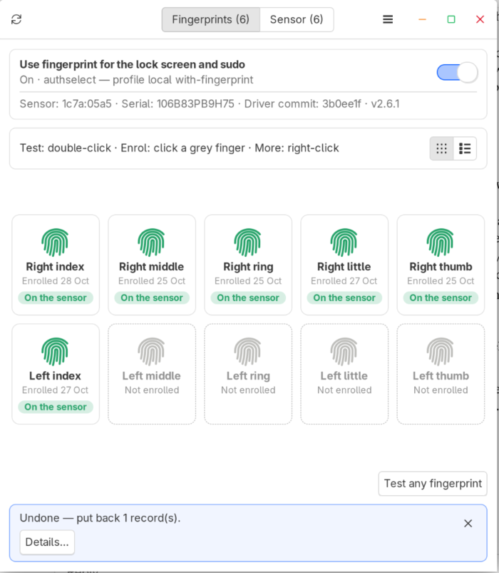
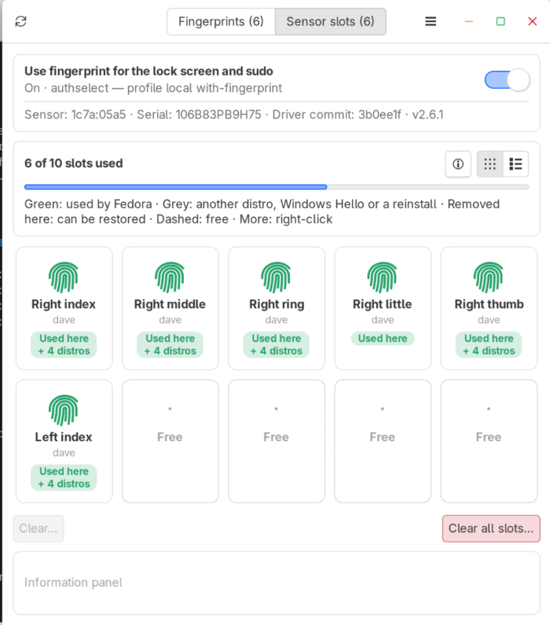
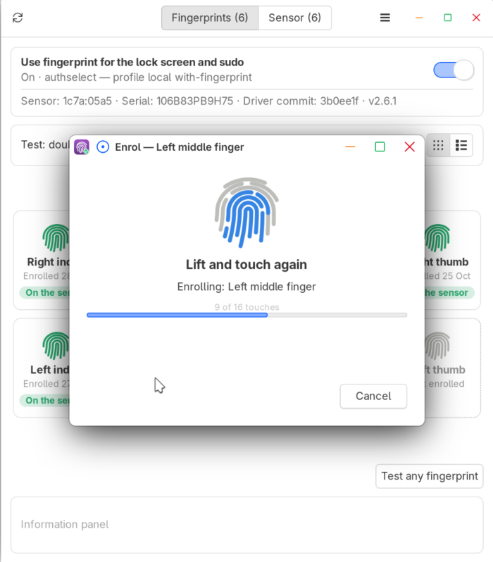
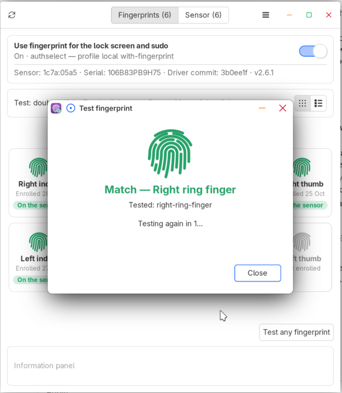

# Galaxy Book Fingerprint Manager

[← Back to the README](../README.md)

A small window for your fingerprints and the sensor, in the app menu as **Galaxy Book Fingerprint Manager** (or run `galaxybook-fingerprint-manager`, as yourself, not with sudo). It asks for your password once per session.

- **Fingerprints tab:** your ten fingers. Click a grey one to enrol it, double-click one to test it, click one for its details, right-click for more (enrol again, remove). **Remove all from <distro>…** takes all your fingers off this distro at once; their slots stay on the sensor, so ☰ → **Restore <distro> fingerprints…** brings them back.
- **Sensor slots tab** (off unless you turn it on with ☰ → **Show sensor slots**; there by itself when other distros use the sensor): the sensor's 10 slots, which are used and which are free. Clear slots you don't need. The ⓘ button explains what a slot is. While it's off, **Show on sensor** (or a full sensor) opens it just for that visit.
- **The switch at the top** turns fingerprint login on or off.
- **☰ menu:** restore fingerprints removed here, show the sensor slots, test whether your distro's own driver now works, check for updates. With other distros on the laptop, more appear: importing their fingerprints, back up & restore, and reset (see [Multi-Distro Mode](multi-distro.md)).
- **Information panel** at the bottom: what just happened (it blinks, and stays until you close it), and the details of a finger or slot you click (gone after 5 seconds).

> [!NOTE]
> **What's a slot?** The sensor has 10 slots, and each holds one enrolled fingerprint: from this Linux, another Linux on the laptop, or Windows Hello. Your fingerprint never leaves the sensor; Linux only notes which slot holds which finger.
> - **Removing a finger** (Fingerprints tab) only takes it off this Linux. Its slot stays filled, so other installs keep it and you can restore it.
> - **Clearing a slot** (Sensor slots tab) erases the fingerprint itself, for every install. It can't be undone: that finger has to be enrolled again.

  
  

  
  

## How it works, in detail

Only one window runs at a time: starting it again brings the open window forward (or makes it flash in the taskbar, depending on the desktop). The installed copy is owned by root (`/usr/local/lib/galaxybook-fingerprint-manager/`, or `/usr/lib/galaxybook-fingerprint-manager/` from a package), because its helper runs as root: a copy in your home folder could be changed by any program running as you. ☰ → **About** shows its version, the installed version and driver commit, and where it came from.

It asks for your password once per session; the prompt says "Galaxy Book Fingerprint Manager needs administrator access to read and manage the fingerprint sensor" (a polkit policy installed for the helper). At the top is a **Use fingerprint for …** switch (its title says what it covers on this system — login, the lock screen and sudo on GNOME and Mint, the lock screen and sudo on KDE, sudo and admin prompts on Arch-based distros) and a line about the sensor, the installed version and the driver commit; below are two tabs:

- **Fingerprints** — your enrolled fingers on this install, and whether the sensor still has each one, as **cards** (all ten of your fingers, right hand then left, like Linux Mint's fingerprint settings; grey dashed = not enrolled, click one to enrol that finger) or as a **list** (a row per enrolled finger, for every user, with its own Test button; other users' fingers are only in the list). The buttons at the top right switch between them (on both tabs), and the choice is remembered. Click a card or row to select it (one at a time, on both tabs) and see its details in the information panel: when it was enrolled and its template (with other distros, also which one enrolled it and which use it); click it again to deselect it. Double-click one of your fingers to test it. Right-click a finger for a menu: **Test**, **Enrol again…** (replace it with a fresh enrolment, if it doesn't match reliably), **Show on sensor** and **Remove from <distro>** (e.g. "Remove from Fedora", the name from /etc/os-release); for a red (dead) finger **Remove dead record…** and **Enrol this finger again…** (removes the dead record, then enrols that finger); for a grey finger **Enrol…** and **Restore removed fingerprint…** (puts back a record removed earlier, if its template is still on the sensor). On the Sensor slots tab, right-click a template for **Show finger** and **Clear slot…** (deletes its fingerprint from the sensor, for every install). A finger you removed from this distro still has its template on the sensor; it shows as that finger with an amber **Removed here** label (not as an unknown template), and its right-click menu has **Restore to <distro>**. Green = on the sensor; red = a dead record (its template was re-enrolled elsewhere or removed by Windows), which also shows a warning with a **Remove dead records** button; amber with ⚠ and **Other driver** = enrolled with a different fingerprint driver (e.g. your distro's own, before this fix), which can never match here — a warning offers **Delete them**, and its right-click menu has **Delete and enrol again…** (deletes its old template from the sensor too, freeing the slot) and **Delete…**.
- **Sensor slots** (off by default, unless other distros use the sensor: ☰ → **Show sensor slots**; while it's off it appears just for a visit when something opens it, e.g. **Show on sensor**) — the sensor itself: how many of the sensor's 10 slots are used, and every template on it: green = used by this install (with the user and finger), grey = not used here, dashed = free. A slot no install has noted shows as "Unknown": Windows Hello's own (Windows wipes Linux's templates but keeps its own), another distro, or one left over from a reinstall. Templates not used here are never deleted without a warning. With other distros, slots also say which of them use each (see [Multi-Distro Mode](multi-distro.md)). Click a slot to see its details in the information panel (who it is, which distros use it, its template, and any distro not seen for a month); click it again to clear them. Shown as cards or a list, like the Fingerprints tab; the Cards / List choice applies to both tabs.

Show every button and what it does

| Where | Control | What it does |
|---|---|---|
| Top | Use fingerprint for … | Turns PAM fingerprint on or off with `fingerprint-pam.sh` (see [Turning Fingerprint Login On or Off](fingerprint-login.md#turning-fingerprint-login-on-or-off)). Turning it off keeps your enrolled fingerprints |
| Fingerprints | Test any fingerprint (or double-click a finger) | The button checks your touch against all your fingers (as login and sudo do); double-clicking a finger tests just that one. Shows a clear Match / No match with the finger that matched. It asks the sensor directly (fprintd pauses for a moment), because fprintd doesn't report which finger matched |
| Fingerprints | Enrol a finger (a grey card, or the last row) | Enrols a new finger for you with `fprintd-enroll`, with a progress bar. It warns first that enrolling a finger already stored for another install or Windows Hello deletes it from there — useful on desktops without a fingerprint settings page, such as Xfce (MX Linux) |
| Fingerprints | Remove from <distro> (right-click a finger, or select it and press Delete) | Moves the record off this install; the template stays, so installs sharing it keep working |
| Fingerprints | Remove all from <distro>… | **Remove from <distro>** for all your fingers at once: the records are moved aside, their slots stay on the sensor, and ☰ → **Restore <distro> fingerprints…** (with **Select all**) brings them back |
| Sensor slots | Clear… (or right-click → Clear slot…) | Clears the selected slots: deletes their fingerprints from the sensor (and moves aside any record here that used them) |
| Sensor slots | Clear all slots… | Deletes every fingerprint on the sensor (every Linux install's and Windows Hello's) after you type CLEAR; moves every record here aside |
| ☰ menu | Restore <distro> fingerprints… | Lists records moved to `removed-fingerprints/` or `replaced-fingerprints/` and puts the chosen ones back — only if their template is still on the sensor and that finger hasn't been enrolled again here |
| ☰ menu | Test your distro's driver… | Checks whether your distro's own libfprint can replace this fix: if it has an SDCP driver for the sensor (from the distro, not another fix), fprintd is switched to it for a moment and one of your fingers is checked with it — the way login would work without the fix. A match offers **Remove fingerprint-fix-sdcp** (or **Copy command**): it removes the fix the way it was installed, keeping your fingerprints, and the Galaxy Book Fingerprint Manager closes. No match: keep the fix, or delete your fingers here first (so they don't stay on the sensor) before switching. The fix is always switched back on after the test |
| ☰ menu | Remind me about Windows | Shows or hides the dual-boot reminder (only in the menu when Windows is found) |
| Fingerprints | Delete and enrol again… / Delete… (right-click an **Other driver** finger) | Deletes a finger enrolled with another driver — its template on the sensor too — and optionally enrols it again with this fix |

Results appear in the **information panel** at the bottom of the window — blue for information, amber for warnings, red for errors — with the full script output behind **Details…**. They blink to catch your eye and stay until you close them or a newer one replaces them. The details of a finger or slot you click show in grey, without blinking, and go after 5 seconds or when you change tabs.

Other things it can show:

- **Windows on the same laptop** — a reminder at the bottom of the window to disable the fingerprint reader in Windows (see [Dual-Boot With Windows](troubleshooting.md#dual-boot-with-windows)). **Got it** hides it; ☰ → **Remind me about Windows** (only there when Windows is found) brings it back.
- **Your distro's libfprint now supports the reader** — when the distro's own, unmodified libfprint gains an SDCP driver for it, a message with **Test your distro's driver** (also in the ☰ menu). If it's an SDCP libfprint from another fix instead, a warning to keep this fix. See [The Monitor](monitoring.md#the-monitor).
- **No Galaxy Book reader** — started on a computer without `1c7a:05a5`, `1c7a:05a1` or `1c7a:0582`, it says what it's for and how to remove the fix, instead of asking for a password.

Records are never deleted: removed ones go to `/var/lib/samsung-galaxybook/removed-fingerprints/<date>/`, and are kept while they can still be restored: a copy goes once its slot is cleared or the finger is back in it. Each sensor job stops fprintd for a moment, as the sensor can only be used by one program at a time.

The installer installs the packages it needs. If any are missing later, the launcher lists them with the command to install them (from a terminal it offers to run it) — PyGObject with GTK 3, libfprint's GObject introspection data and pkexec:

- Fedora: `sudo dnf install python3-gobject python3-cairo gtk3` (introspection data comes with libfprint)
- Debian / Ubuntu / Mint / MX: `sudo apt install python3-gi python3-gi-cairo gir1.2-gtk-3.0 gir1.2-fprint-2.0 pkexec`
- Arch / CachyOS: `sudo pacman -S python-gobject python-cairo gtk3` (introspection data comes with libfprint)
