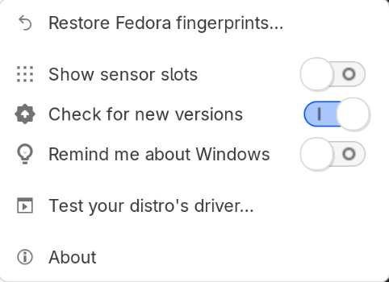

# Multi-Distro Mode

[← Back to the README](../README.md)

The other guides are all one distro needs. This guide is for laptops with **several Linux distros** using the one sensor.

**The Galaxy Book Fingerprint Manager switches to multi-distro mode by itself.** Each distro that runs it notes itself (and where it's installed: its partition) in one file on the EFI partition, `EFI/samsung-galaxybook/fingerprint-slots.json`, which every OS on the laptop shares and which survives reinstalling a distro. Each time the Manager opens, it reads that file and checks the other distros still exist: one whose partition has been deleted or reformatted (reinstalled) is no longer listed, and a short message says so. A distro on a second drive that isn't connected is left as it is. As soon as another distro is found, the multi-distro parts appear: the **Sensor slots** tab, and in the ☰ menu **Import from other distros…**, **Back up & restore…** and **Reset <distro>…**. When the others are gone, it goes back to single-distro mode. (`galaxybook-fingerprint-manager --single-distro` shows the single-distro layout anyway, e.g. to try it; only what's shown changes.)

## The ☰ menu with one distro, and in multi-distro mode

<p>
  
  
</p>

## Sharing Fingerprints

Enrol each finger **once** and share it, instead of enrolling it again on every distro. Enrolling the same finger on another distro deletes it from the others, and sharing keeps the sensor's 10 slots free. fprintd's record for a finger holds only the ID of its slot on the sensor (no fingerprint image, no secret), so the same record works on every distro that runs this fix.

1. Each distro notes its fingers' records in the shared file on the EFI partition.
2. When the Manager opens on another distro (a new one, a reinstalled one, or one you've just reset), it asks *Use these fingerprints on CachyOS too?* and lists the fingers it could use, each with the distros it's from.
3. Untick any that aren't yours, then **Import**. They work straight away, with no enrolling.

Turned one down? It isn't offered again by itself, but ☰ → **Import from other distros…** always lists them all. A finger you removed here comes back with ☰ → **Restore <distro> fingerprints…** (or right-click it → **Restore removed fingerprint…**). A record goes when its slot is cleared, so you're never offered a finger that can't match.

- **Don't enrol the same finger on another distro.** Import it instead.
- **Remove** (Fingerprints tab) takes a finger off one distro only; the others keep it. **Clear slot** (Sensor slots tab) erases it from the sensor, for every distro.
- With several distros, clicking a finger or slot also shows which distro enrolled it and which use it.

## Reinstalling or Removing a Distro

- **Reinstalling:** just reinstall it. When the Manager opens on the new install, it offers your fingerprints; nothing to enrol again. The old install is noticed as gone (its partition was reformatted) and no longer listed.
- **Removing:** removing the Manager (dnf / apt / pacman, or `uninstall.sh`; not an update) takes this distro out of the file. A distro deleted without that is noticed as gone at the next start of the Manager elsewhere; **Other distros…** on the Sensor slots tab lists them all and can **Forget…** one by hand.

## Reset

☰ → **Reset <distro>…** deletes that distro's fingerprints for good, and erases from the sensor **the slots no other distro uses**: nothing can bring those fingers back (not an import, not a backup); they have to be enrolled again. Slots other distros also use are kept, and you're asked straight after whether to import them again. The confirmation names which fingers are lost and which are kept. The distro is also taken out of the shared file. If the EFI partition can't be read when you confirm, Reset changes nothing and says why, as it can't tell which slots the other distros use. You don't need it to reinstall a distro.

## Back Up & Restore

The file on the EFI partition holds every distro's records. Formatting that partition (reinstalling Windows can) loses them: your fingerprints are still on the sensor, but no distro knows which slot is whose. A backup puts them back.

☰ → **Back up & restore…** says how many records the file has, and:

- **Back up…** saves a copy of it, e.g. `~/galaxybook-fingerprints-2026-10-29.json`. Keep it somewhere safe, such as a USB stick. Make a new one after enrolling new fingers.
- **Restore…** puts a backup's records back. Records already there are kept as they are; only missing ones are added. Then the Manager offers the fingers this distro can use, and the other distros offer theirs the next time it opens there.

A backup holds no fingerprints, only which slot is whose: it's useless without this laptop's sensor and your finger. A finger whose slot has been cleared since the backup can't be restored; enrol it again.

## The multi-distro buttons

| Where | Control | What it does |
|---|---|---|
| ☰ menu | Import from other distros… | The fingers this install could use from the other distros on the laptop (also ones you turned down before), ticked ones imported through `import-fingerprint.sh` with all its checks |
| ☰ menu | Reset <distro>… | Deletes this distro's fingerprints for good: clears the slots only it uses (they have to be enrolled again), keeps the ones other distros also use and offers them back, and takes it out of the shared slots file. The confirmation names the fingers lost and kept. Not needed to reinstall a distro |
| Sensor slots | Other distros… | Every distro in the shared slots file, with the date it last opened the Manager and its slots. **Forget…** takes a wiped or reinstalled one out; **Forget and clear N slots** also erases the slots only it used. Also in the ⓘ dialog. Only shown when other distros are listed |
| ☰ menu | Back up & restore… | Says how many records the EFI partition has; **Back up…** saves a copy of `fingerprint-slots.json` from the EFI partition (every distro's records) as a `.json` file; **Restore…** merges one back (adds what's missing, changes nothing there) and the Manager offers the fingers again |

## Without the Manager

A distro with only the driver doesn't use the shared file, and the export and import tools come with the Manager (or a `git clone` of this repository). Share fingerprints with an export file instead. On the distro where the fingers are enrolled:

```bash
sudo bash tools/export-fingerprint.sh     # writes ~/fingerprint-export.tgz
```

Copy that file to your home folder on the other distro, then:

```bash
sudo bash tools/import-fingerprint.sh     # reads ~/fingerprint-export.tgz
```

`install.sh` imports `~/fingerprint-export.tgz` by itself when it's there. Only fingers whose slot is still on the sensor are imported, fingers you already have are kept, and the user name doesn't have to match (that needs the Manager installed). Export again after deleting or re-enrolling a finger: an old export points at slots that no longer exist.
