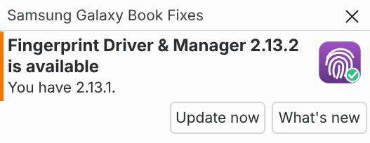
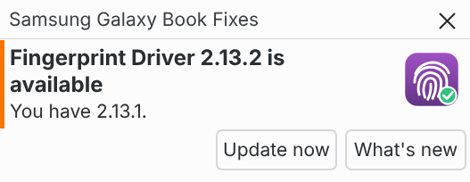

# Updating

[← Back to the README](../README.md)

How to update: from the new-version notification, with the Galaxy Book Fingerprint Manager, with only the driver, or an `install.sh` copy.

## From the update notification

You're told about each new release with a notification, checked 30 seconds after login and then hourly. This works with the driver alone too. Nothing is installed until you choose to, and enrolled fingerprints are always kept.

## With the Galaxy Book Fingerprint Manager

Click the notification's **Update now** (or the Manager's **Update** button): it downloads the new files and installs them in a terminal window, where you confirm with your fingerprint or password.

From a terminal (no `sudo`; `update` asks for your password when it installs):

| Command | What it does |
| --- | --- |
| `galaxybook-fingerprint-manager update` | Install the newest release: downloads, checks and installs what you have installed in this terminal |
| `galaxybook-fingerprint-manager updates on` / `off` | "New version" notifications on or off (the same as the Manager's switch) |
| `galaxybook-fingerprint-manager updates status` | Are they on? (checked hourly) |
| `galaxybook-fingerprint-manager updates check` | Look now; if there's a new version, show the notification |

`galaxybook-fingerprint-manager --help` lists them all.

## With only the driver

Click the notification's **Update now**: it downloads the driver's new file and installs it in a terminal window, where you confirm with your password. It doesn't add the Manager. On Arch-based distros, it builds the driver on your laptop first, from the release's `PKGBUILD-driver`.

From a terminal (no `sudo`; `update` asks for your password when it installs):

| Command | What it does |
| --- | --- |
| `fingerprint-fix-sdcp update` | Install the newest driver: downloads, checks and installs it in this terminal |
| `fingerprint-fix-sdcp updates on` / `off` | "New version" notifications on or off |
| `fingerprint-fix-sdcp updates status` | Are they on? (checked hourly) |
| `fingerprint-fix-sdcp updates check` | Look now; if there's a new version, show the notification |

`fingerprint-fix-sdcp --help` lists them all. If the Manager is installed, this command changes nothing and names the Manager's command to run instead.

**On 2.11.4 or older?** These don't have **Update now** or this command yet, so update once by hand: download the driver's new file from the [latest release](https://github.com/david-bartlett/fingerprint-fix-sdcp/releases/latest) and install it as in [Installing only one package](install-options.md#installing-only-one-package). To turn the notifications off on those versions, use `systemctl --user mask fingerprint-fix-sdcp-update-check.timer`, and `unmask` to turn them back on.

## Installed with install.sh

In the `fingerprint-fix-sdcp` folder, `git pull`, then `sudo bash install.sh` again. The `fingerprint-fix-sdcp` command comes with the package, so with only the driver, use `systemctl --user disable fingerprint-fix-sdcp-update-check.timer` to turn the notifications off, and `enable` to turn them back on.

How the update check works

- The notification comes once per version, with **Update now** (when installed from a package: what you have is downloaded, checked against the release's `SHA256SUMS` and installed together) and **What's new** (the release page; the notification comes back afterwards). On GNOME, hover over it to see the buttons, or click it for **What's new**.
- The notification stays on screen until you close it, or until the new version is installed some other way, such as the Manager's **Update** button or `galaxybook-fingerprint-manager update`.
- Only one check runs: the driver's own check is skipped while the Manager is installed.
- A release is only announced once its files are attached, so **Update** always has something to install.
- With no terminal found, the Manager's **Update** saves the files to `~/Downloads` instead, with the command to paste.
- **Turn it off** in the Manager: ☰ → *Check for new versions*, or `galaxybook-fingerprint-manager updates off`.
- Turning it off in the Manager also turns off the driver's check, and that stays off if you remove the Manager; removing it tells you so, with a **Turn on** button.

